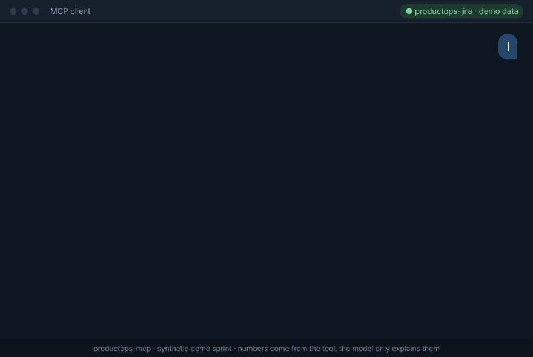

# productops-mcp

[](https://www.npmjs.com/package/@productops-mcp/prioritization)
[](https://www.npmjs.com/package/@productops-mcp/jira)
[](https://github.com/EugeneNeverov/productops-mcp/actions/workflows/ci.yml)
[](LICENSE)

Open-source Product Operations toolkit built on the Model Context Protocol: local prioritization (RICE, WSJF, capacity scenarios) and Jira sprint intelligence, plus reusable agent skills. Calculations are done by code; the model only explains the results.



<sub>The tool result is the real output of `assess_sprint_health` on the synthetic demo sprint; the answer is an abridged version of the skill's [example report](skills/sprint-health-audit/examples/demo-report.md). Regenerate with `node scripts/demo/make-demo-gif.mjs`.</sub>

## Install

Both servers run locally over stdio and need Node.js 20 or newer. Neither needs an account to try: each ships demo data.

**Claude Code**

```sh
claude mcp add productops-prioritization -- npx -y @productops-mcp/prioritization
claude mcp add productops-jira -- npx -y @productops-mcp/jira
```

**Claude Desktop**: download `productops-prioritization-<version>.mcpb` or `productops-jira-<version>.mcpb` from the [latest release](https://github.com/EugeneNeverov/productops-mcp/releases/latest) and open it, or add the servers to the config as below.

**Any MCP client** (Claude Desktop, LM Studio, Cursor and others):

```json
{
  "mcpServers": {
    "productops-prioritization": {
      "command": "npx",
      "args": ["-y", "@productops-mcp/prioritization"],
      "env": { "PRODUCTOPS_DATA_DIR": "/path/to/your/backlogs" }
    },
    "productops-jira": {
      "command": "npx",
      "args": ["-y", "@productops-mcp/jira"]
    }
  }
}
```

Then ask: "Rank the demo backlog with RICE and WSJF and tell me where they disagree", or "How is the current sprint on the demo PAY board going?". To read your own Jira Cloud, run `npx -y @productops-mcp/jira login` once and set `PRODUCTOPS_JIRA_MODE=live` ([docs/jira-live.md](docs/jira-live.md)).

## Packages

| Package                          | What it is                                                                                                                                                                                                                                                                                                                  |
| -------------------------------- | --------------------------------------------------------------------------------------------------------------------------------------------------------------------------------------------------------------------------------------------------------------------------------------------------------------------------- |
| `@productops-mcp/core`           | Shared schemas (`Meta`, `ToolError`), tool runtime, policy, config, stderr logger                                                                                                                                                                                                                                           |
| `@productops-mcp/prioritization` | Local MCP server (stdio), fully offline: `calculate_rice`, `calculate_wsjf`, `compare_initiatives`, `simulate_capacity`, `explain_ranking`, optional `triumvirate_brief` / `triumvirate_verdict` (three independent judges)                                                                                                 |
| `@productops-mcp/jira`           | Read-only MCP server (stdio) for sprint health: `list_projects`, `get_sprint_issues`, `analyze_cycle_time`, `find_blockers`, `assess_sprint_health`. Ships a synthetic demo dataset; reads your Jira Cloud through the official Atlassian MCP server after `productops-jira login` ([docs/jira-live.md](docs/jira-live.md)) |

## Try it from a checkout

After `pnpm install && pnpm build`, ask the server to rank the bundled demo backlog:

```sh
pnpm client packages/mcp-prioritization/dist/bin.js calculate_rice '{"initiatives":{"kind":"demo"}}'
```

And audit the demo team's sprint (synthetic Jira data, no account needed):

```sh
pnpm client packages/mcp-jira/dist/bin.js assess_sprint_health '{"boardId":1}'
```

Your own backlog goes in a CSV or JSON file inside an allowed folder: `PRODUCTOPS_DATA_DIR`, `./data`, or the folders in `productops.config.json`. The columns match the fields in [docs/algorithms.md](docs/algorithms.md); the sprint metrics are defined in [docs/metrics.md](docs/metrics.md). Sample outputs are in [examples/reports/demo](examples/reports/demo).

## Skills

[`skills/roadmap-prioritization`](skills/roadmap-prioritization/SKILL.md) turns the tools into a recommendation a product manager can act on: what to take, what to defer, the trade-offs, where the methods disagree, and how to reproduce every number. It is also served as the MCP prompt `roadmap-prioritization`, so it works in clients without Agent Skills support, such as LM Studio. [`skills/sprint-health-audit`](skills/sprint-health-audit/SKILL.md) does the same for a sprint (MCP prompt `sprint-health-audit`). See [skills/README.md](skills/README.md) and an [example report](skills/roadmap-prioritization/examples/demo-report.md).

Skill quality is measured by [evals](evals/README.md): 10 cases, deterministic checks (every number and id must come from a tool), and a runner for any OpenAI-compatible endpoint, LM Studio included.

## Development

Requires Node.js ≥ 22.12 and pnpm 10 (`corepack enable`). Published packages run on Node ≥ 20.

```sh
pnpm install
pnpm test          # build, then unit + e2e tests
pnpm lint && pnpm format:check
pnpm client        # start the built server and call `ping` through a real MCP client
```

To connect a client to your checkout instead of npm, see [examples/clients](examples/clients/README.md). Design decisions are recorded in [docs/decisions](docs/decisions). Releases are described in [docs/releasing.md](docs/releasing.md) and listed in [CHANGELOG.md](CHANGELOG.md).

## License

Apache-2.0, see [LICENSE](LICENSE). This license covers the code in this repository only. Use of third-party APIs (Atlassian Jira, Google Analytics and others) is governed by those providers' own terms.
